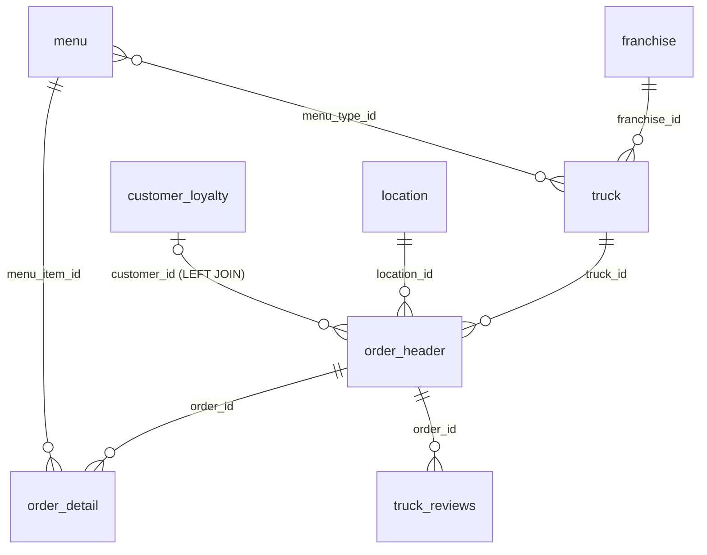

# 中核データモデル（raw_pos / raw_customer）

ほぼすべての Tasty Bytes 教材が共有する「中核 8 テーブル」と、Zero to Snowflake v2 で追加された `raw_support.truck_reviews` / `raw_pos.truck_details` を解説します。

## 出典

| 版 | データベース | 出典 |
| --- | --- | --- |
| v1（2023-03-17 初版、作成者 Jacob Kranzler） | `frostbyte_tasty_bytes` | [`tb_introduction.sql`](../../snowflake_contents/github/common_resources/sf-samples/samples/tasty_bytes/tb_introduction.sql)（[原本](https://github.com/Snowflake-Labs/sf-samples/blob/a291149cf20f8b52fc2cd31f92b09671c415bee2/samples/tasty_bytes/tb_introduction.sql)） |
| FY25 Zero to Snowflake（Version: v2） | `tb_101` | [`tb_introduction.sql`](../../snowflake_contents/github/common_resources/sf-samples/samples/tasty_bytes/FY25_Zero_To_Snowflake/tb_introduction.sql)（[原本](https://github.com/Snowflake-Labs/sf-samples/blob/a291149cf20f8b52fc2cd31f92b09671c415bee2/samples/tasty_bytes/FY25_Zero_To_Snowflake/tb_introduction.sql)） |
| Zero to Snowflake Setup（Version: v2、Copyright 2025） | `tb_101` | [`setup.sql`](../../snowflake_contents/github/common_resources/sfguide-getting-started-from-zero-to-snowflake/scripts/setup.sql)（[原本](https://github.com/Snowflake-Labs/sfguide-getting-started-from-zero-to-snowflake/blob/e12f556e2c23c155ddc6ac8a1be4953bb93332b0/scripts/setup.sql)） |
| Zero to Snowflake 日本語ハンズオン | `tb_101` | [`01_tb_introduction.sql`](../../snowflake_contents/github/common_resources/zero-to-snowflake-ja/sql/01_tb_introduction.sql)（[原本](https://github.com/Snowflake-Labs/zero-to-snowflake-ja/blob/47239042d9d7bfb882f5aaab503fe98e2ac42657/sql/01_tb_introduction.sql)） |
| 列の説明文（dbt のソース定義） | `tasty_bytes_dbt_db.raw` | [`__sources.yml`](../../snowflake_contents/github/data_engineering_dbt/getting-started-with-dbt-on-snowflake/tasty_bytes_dbt_demo/models/staging/__sources.yml)（[原本](https://github.com/Snowflake-Labs/getting-started-with-dbt-on-snowflake/blob/ce9dfd8fc6c9d0fb4c46d3df16503efe210ae249/tasty_bytes_dbt_demo/models/staging/__sources.yml)） |

上の 4 つの SQL で、中核 8 テーブルの列名・型・列順は同じです（比較して確認済み）。このうち Zero to Snowflake Setup（v2）だけが、`raw_support.truck_reviews` と `raw_pos.truck_details` を追加で作ります。FY25 版と日本語ハンズオンの導入 SQL には、この 2 つはありません。

列の「説明」欄は dbt の `__sources.yml` の `description` を訳したものです。dbt 側の説明がない列は「—」としています。`customer_loyalty` には dbt の説明がありません。

## 読み込み方法

v2 Setup では、次のファイル形式とステージを作ってから `COPY INTO` で読み込みます。

```sql
CREATE OR REPLACE FILE FORMAT tb_101.public.csv_ff type = 'csv';

CREATE OR REPLACE STAGE tb_101.public.s3load
url = 's3://sfquickstarts/frostbyte_tastybytes/'
file_format = tb_101.public.csv_ff;

CREATE OR REPLACE STAGE tb_101.public.truck_reviews_s3load
url = 's3://sfquickstarts/tastybytes-voc/'
file_format = tb_101.public.csv_ff;
```

| テーブル | 読み込み元（ステージ上のパス） |
| --- | --- |
| `raw_pos.country` | `@s3load/raw_pos/country/` |
| `raw_pos.franchise` | `@s3load/raw_pos/franchise/` |
| `raw_pos.location` | `@s3load/raw_pos/location/` |
| `raw_pos.menu` | `@s3load/raw_pos/menu/` |
| `raw_pos.truck` | `@s3load/raw_pos/truck/` |
| `raw_pos.order_header` | `@s3load/raw_pos/order_header/` |
| `raw_pos.order_detail` | `@s3load/raw_pos/order_detail/` |
| `raw_customer.customer_loyalty` | `@s3load/raw_customer/customer_loyalty/` |
| `raw_support.truck_reviews` | `@truck_reviews_s3load/raw_support/truck_reviews/` |

ファイル形式は `type = 'csv'` だけで、`SKIP_HEADER` は指定していません。一方、価格最適化のセットアップは `skip_header = 1` などを指定し、ファイル名（例: `menu/menu.csv`）を明示します（[`tb_po_setup.sql`](../../snowflake_contents/github/cortex_ai_machine_learning/sfguide-price-optimization-using-snowflake-notebooks-and-streamlit/scripts/sql/tb_po_setup.sql)（[原本](https://github.com/Snowflake-Labs/sfguide-price-optimization-using-snowflake-notebooks-and-streamlit/blob/ea6f0cf42587e4b238f24a6514f8e2c1a1b89f08/scripts/sql/tb_po_setup.sql)））。**[推測]** 読み込むバケットのパスが同じでも、教材によってファイルの構成やヘッダーの有無が違う可能性があります。

## エンティティ関係

主キー・外部キーの制約は、どのセットアップ SQL でも宣言されていません。下の図は、`harmonized.orders_v` などのビューで使われている結合条件をもとに描いたものです。



- `orders_v` は `order_detail` を起点に、`order_header`・`truck`・`menu`・`franchise`・`location` を内部結合し、`customer_loyalty` だけを左外部結合します。つまり、ロイヤルティ会員でない顧客の注文も含みます。
- `truck_reviews_v` は `menu.menu_type_id = truck.menu_type_id` で結合し、`SELECT DISTINCT` を付けています。
- `country` は `orders_v` には結合されません。気象データのビュー `daily_weather_v` で `country.iso_country` と `country.city` を使って結合されます（[Marketplace・第三者データ](marketplace-third-party-data.md)）。

## テーブル定義

### `raw_pos.country` — 国・都市の参照データ

dbt の説明: Country reference data（国の参照データ）。1 行が 1 つの「国×都市」の組み合わせです（列構成から判断）。

| 列 | 型 | 説明（dbt） |
| --- | --- | --- |
| `country_id` | `NUMBER(18,0)` | 国の主キー |
| `country` | `VARCHAR` | 国名 |
| `iso_currency` | `VARCHAR(3)` | ISO 通貨コード |
| `iso_country` | `VARCHAR(2)` | ISO 国コード |
| `city_id` | `NUMBER(19,0)` | 都市 ID |
| `city` | `VARCHAR` | 都市名 |
| `city_population` | `VARCHAR` | 都市の人口（dbt では正の値であることをテスト） |

`city_population` は人口を表す列ですが、型は `VARCHAR` です。分散 PyTorch 教材の定義だけは `NUMBER(38,0)` です（[版差異](version-differences.md)）。

### `raw_pos.franchise` — フランチャイズオーナー

dbt の説明: Franchise ownership data。

| 列 | 型 | 説明（dbt） |
| --- | --- | --- |
| `franchise_id` | `NUMBER(38,0)` | フランチャイズの主キー |
| `first_name` | `VARCHAR` | オーナーの名 |
| `last_name` | `VARCHAR` | オーナーの姓 |
| `city` | `VARCHAR` | 拠点の都市 |
| `country` | `VARCHAR` | 拠点の国 |
| `e_mail` | `VARCHAR` | 連絡用メールアドレス |
| `phone_number` | `VARCHAR` | 連絡用電話番号 |

### `raw_pos.location` — 販売場所

dbt の説明: Business locations data。

| 列 | 型 | 説明（dbt） |
| --- | --- | --- |
| `location_id` | `NUMBER(19,0)` | 場所の主キー（dbt では一意・非 NULL をテスト） |
| `placekey` | `VARCHAR` | 標準的な場所識別子（dbt では一意をテスト） |
| `location` | `VARCHAR` | 場所の名前 |
| `city` | `VARCHAR` | 都市名 |
| `region` | `VARCHAR` | 地域 |
| `iso_country_code` | `VARCHAR` | ISO 国コード |
| `country` | `VARCHAR` | 国名 |

`placekey` は SafeGraph のデータと結合するためのキーとして使われます。Power BI 教材は「Placekey field can be used to accurately join the SafeGraph dataset together with our Tasty Bytes dataset」と述べています（[`end-to-end-analytics-with-snowflake-and-power-bi.md`](../../snowflake_contents/training/bi_analytics/end-to-end-analytics-with-snowflake-and-power-bi.md)（[原本](https://github.com/Snowflake-Labs/sfquickstarts/blob/b186c148d09b971fcf99e693ffa70312b196e0ec/site/sfguides/src/end-to-end-analytics-with-snowflake-and-power-bi/end-to-end-analytics-with-snowflake-and-power-bi.md)））。一方、Zero to Snowflake の地理空間教材と Snowpark 101 は `location_id` で SafeGraph と結合します（[Marketplace・第三者データ](marketplace-third-party-data.md)）。

### `raw_pos.menu` — メニュー

dbt の説明: Food menu items data。

| 列 | 型 | 説明（dbt） |
| --- | --- | --- |
| `menu_id` | `NUMBER(19,0)` | メニュー項目の主キー |
| `menu_type_id` | `NUMBER(38,0)` | メニュー種別の参照 |
| `menu_type` | `VARCHAR` | メニュー種別 |
| `truck_brand_name` | `VARCHAR` | トラックのブランド名 |
| `menu_item_id` | `NUMBER(38,0)` | メニュー上の品目 ID |
| `menu_item_name` | `VARCHAR` | 品目名 |
| `item_category` | `VARCHAR` | 品目のカテゴリ |
| `item_subcategory` | `VARCHAR` | — |
| `cost_of_goods_usd` | `NUMBER(38,4)` | 原価（USD） |
| `sale_price_usd` | `NUMBER(38,4)` | 販売価格（USD） |
| `menu_item_health_metrics_obj` | `VARIANT` | 品目の健康指標（JSON） |

`menu_item_health_metrics_obj` は半構造化データです。構造は [半構造化データ](semi-structured-data.md#menu_item_health_metrics_obj) を参照してください。

`menu_type_id` はトラック（`truck.menu_type_id`）とメニューを結び付けるキーです。ブランド名は `menu` 側にしかないため、トラックのブランドを知るには `menu_type_id` で `menu` を参照します（`truck_reviews_v` やカスタマーエクスペリエンスアプリの `inspection_reports_v` がこの結合を使います）。

### `raw_pos.truck` — フードトラック

dbt の説明: Food truck data。

| 列 | 型 | 説明（dbt） |
| --- | --- | --- |
| `truck_id` | `NUMBER(38,0)` | トラックの主キー |
| `menu_type_id` | `NUMBER(38,0)` | トラックのメニュー種別 |
| `primary_city` | `VARCHAR` | 主な営業都市 |
| `region` | `VARCHAR` | 営業地域 |
| `iso_region` | `VARCHAR` | ISO 地域コード |
| `country` | `VARCHAR` | 営業国 |
| `iso_country_code` | `VARCHAR` | ISO 国コード |
| `franchise_flag` | `NUMBER(38,0)` | フランチャイズかどうか |
| `year` | `NUMBER(38,0)` | 製造年 |
| `make` | `VARCHAR` | メーカー |
| `model` | `VARCHAR` | 車種 |
| `ev_flag` | `NUMBER(38,0)` | 電気自動車かどうか |
| `franchise_id` | `NUMBER(38,0)` | フランチャイズへの外部キー |
| `truck_opening_date` | `DATE` | 営業開始日 |

Cortex Analyst のセマンティックモデルは `FRANCHISE_FLAG` を「1 or 0 to indicate whether the truck is franchised. 1 is true, 0 is false」と説明しています（[`sales_detail_semantic_model.yaml`](../../snowflake_contents/github/common_resources/sf-samples/samples/cortex-analyst/Cortex%20Analyst%20Tasty%20Bytes/sales_detail_semantic_model.yaml)（[原本](https://github.com/Snowflake-Labs/sf-samples/blob/a291149cf20f8b52fc2cd31f92b09671c415bee2/samples/cortex-analyst/Cortex%20Analyst%20Tasty%20Bytes/sales_detail_semantic_model.yaml)））。

v2 Setup は読み込み後に `truck_build OBJECT` 列を追加し、`year`・`make`・`model` から `OBJECT_CONSTRUCT` で値を作ります。続けて、`truck_build:make` が `'Ford_'` で `truck_id` が偶数の行だけ、`make` を `'Ford'` に置き換えます（SQL のコメントは「Messing up make data in truck_build object」）。その後、`year`・`make`・`model` を除いた `raw_pos.truck_details` を CTAS で作ります。

```sql
CREATE OR REPLACE TABLE tb_101.raw_pos.truck_details
AS
SELECT * EXCLUDE (year, make, model)
FROM tb_101.raw_pos.truck;
```

vignette-1 は、この `truck_details.truck_build` から `year`・`make`・`model` を取り出し、`'Ford'` と `'Ford_'` が混在しているデータ品質の問題を直す演習に使います（[`vignette-1.sql`](../../snowflake_contents/github/common_resources/sfguide-getting-started-from-zero-to-snowflake/scripts/vignette-1.sql)（[原本](https://github.com/Snowflake-Labs/sfguide-getting-started-from-zero-to-snowflake/blob/e12f556e2c23c155ddc6ac8a1be4953bb93332b0/scripts/vignette-1.sql)））。

### `raw_pos.order_header` — 注文ヘッダー

dbt の説明: Order header information。

| 列 | 型 | 説明（dbt） |
| --- | --- | --- |
| `order_id` | `NUMBER(38,0)` | 注文の主キー |
| `truck_id` | `NUMBER(38,0)` | トラックへの外部キー |
| `location_id` | `FLOAT` | 場所への外部キー |
| `customer_id` | `NUMBER(38,0)` | 顧客 ID |
| `discount_id` | `VARCHAR` | 注文に適用された割引 |
| `shift_id` | `NUMBER(38,0)` | シフト ID |
| `shift_start_time` | `TIME(9)` | シフト開始時刻 |
| `shift_end_time` | `TIME(9)` | シフト終了時刻 |
| `order_channel` | `VARCHAR` | 注文チャネル（app, in-person） |
| `order_ts` | `TIMESTAMP_NTZ(9)` | 注文日時 |
| `served_ts` | `VARCHAR` | 提供日時 |
| `order_currency` | `VARCHAR(3)` | 注文の通貨 |
| `order_amount` | `NUMBER(38,4)` | 税抜の注文金額 |
| `order_tax_amount` | `VARCHAR` | 税額 |
| `order_discount_amount` | `VARCHAR` | 割引額 |
| `order_total` | `NUMBER(38,4)` | 注文の合計金額 |

型の注意点:

- `location_id` は `FLOAT` ですが、`location.location_id` は `NUMBER(19,0)` です。
- `served_ts`・`order_tax_amount`・`order_discount_amount` は値の意味に対して `VARCHAR` です。宣言型パイプライン教材は `order_discount_amount` を `TRY_TO_NUMBER` で `NUMBER(10,2)` に変換するよう指示しています（[`01_dynamic_tables.sql`](../../snowflake_contents/github/data_engineering_dbt/sfguide-declarative-pipelines-dynamic-tables/01_dynamic_tables.sql)（[原本](https://github.com/Snowflake-Labs/sfguide-declarative-pipelines-dynamic-tables/blob/9937421fb54bae4a3e90ec46850e26fab862f5c0/01_dynamic_tables.sql)））。

参考として、Modern Data Engineering 教材に同梱の [`sample_orders.csv`](../../snowflake_contents/github/data_engineering_dbt/modern-data-engineering-snowflake/module-2/sample_orders.csv)（[原本](https://github.com/Snowflake-Labs/modern-data-engineering-snowflake/blob/824bc65c1599508a19278ff618abac39e8faa464/module-2/sample_orders.csv)） は同じ 16 列のヘッダーを持つ CSV で、ヘッダーを除くデータは 10,034 行です（Python の `csv` モジュールで数えた値）。先頭行の `ORDER_TS` は `2022-09-23T11:07:45.000Z` の形式です。

### `raw_pos.order_detail` — 注文明細

dbt の説明: Order line item details。

| 列 | 型 | 説明（dbt） |
| --- | --- | --- |
| `order_detail_id` | `NUMBER(38,0)` | 注文明細の主キー |
| `order_id` | `NUMBER(38,0)` | 注文ヘッダーへの外部キー |
| `menu_item_id` | `NUMBER(38,0)` | メニューへの外部キー |
| `discount_id` | `VARCHAR` | 任意の割引 |
| `line_number` | `NUMBER(38,0)` | 注文内の行番号 |
| `quantity` | `NUMBER(5,0)` | 数量 |
| `unit_price` | `NUMBER(38,4)` | 単価 |
| `price` | `NUMBER(38,4)` | 明細の合計価格 |
| `order_item_discount_amount` | `VARCHAR` | 明細の割引額 |

Cortex Analyst のセマンティックモデルは `PRICE` を「Total price for the order line, equal to unit price multiplied by quantity」と説明しています。

### `raw_customer.customer_loyalty` — ロイヤルティ会員

| 列 | 型 |
| --- | --- |
| `customer_id` | `NUMBER(38,0)` |
| `first_name` | `VARCHAR` |
| `last_name` | `VARCHAR` |
| `city` | `VARCHAR` |
| `country` | `VARCHAR` |
| `postal_code` | `VARCHAR` |
| `preferred_language` | `VARCHAR` |
| `gender` | `VARCHAR` |
| `favourite_brand` | `VARCHAR` |
| `marital_status` | `VARCHAR` |
| `children_count` | `VARCHAR` |
| `sign_up_date` | `DATE` |
| `birthday_date` | `DATE` |
| `e_mail` | `VARCHAR` |
| `phone_number` | `VARCHAR` |

氏名・メール・電話番号・生年月日を含むため、ガバナンス系の教材でマスキングや行アクセスポリシーの対象になります（例: [`vignette-4.sql`](../../snowflake_contents/github/common_resources/sfguide-getting-started-from-zero-to-snowflake/scripts/vignette-4.sql)（[原本](https://github.com/Snowflake-Labs/sfguide-getting-started-from-zero-to-snowflake/blob/e12f556e2c23c155ddc6ac8a1be4953bb93332b0/scripts/vignette-4.sql)）、[`tb_zts_data_governance.sql`](../../snowflake_contents/github/common_resources/sf-samples/samples/tasty_bytes/tb_zts_data_governance.sql)（[原本](https://github.com/Snowflake-Labs/sf-samples/blob/a291149cf20f8b52fc2cd31f92b09671c415bee2/samples/tasty_bytes/tb_zts_data_governance.sql)））。

<a id="truck-reviews"></a>

### `raw_support.truck_reviews` — トラックのレビュー（v2 で追加）

| 列 | 型（`tb_101`） | 型（`tb_voc` ほか） |
| --- | --- | --- |
| `order_id` | `NUMBER(38,0)` | `NUMBER(38,0)` |
| `language` | `VARCHAR` | `VARCHAR` |
| `source` | `VARCHAR` | `VARCHAR` |
| `review` | `VARCHAR` | `VARCHAR` |
| `review_id` | `NUMBER(38,0)` | `NUMBER(18,0)` |

`review` は多言語の自由記述テキストです。内容と使い方は [非構造化データ](unstructured-data.md#truck-reviews) を参照してください。

## 関連ページ

- [ER 図（全テーブル）](er-diagram.md)
- [ソースデータの全体像](source-data-overview.md)
- [整合・分析レイヤのビュー](harmonized-analytics-views.md)
- [半構造化データ](semi-structured-data.md)
- [版による差異・矛盾](version-differences.md)
