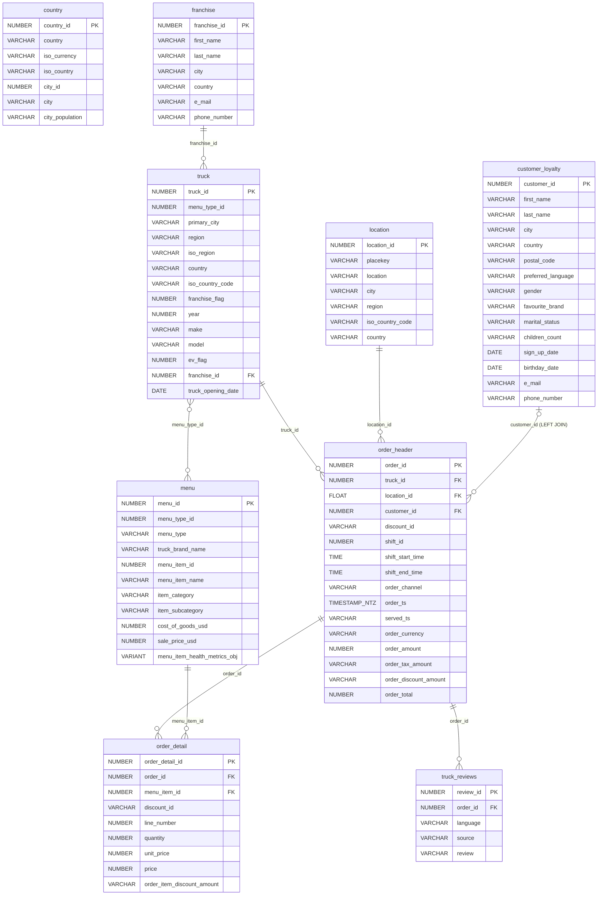
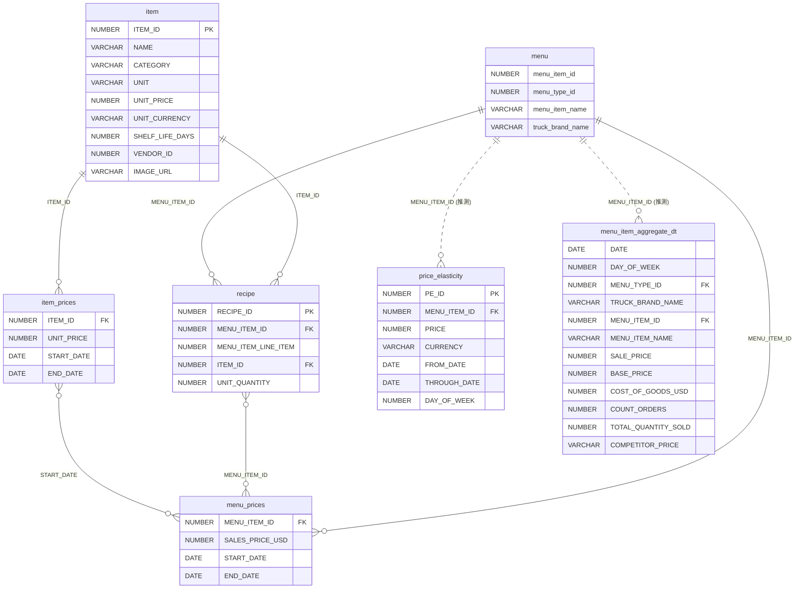
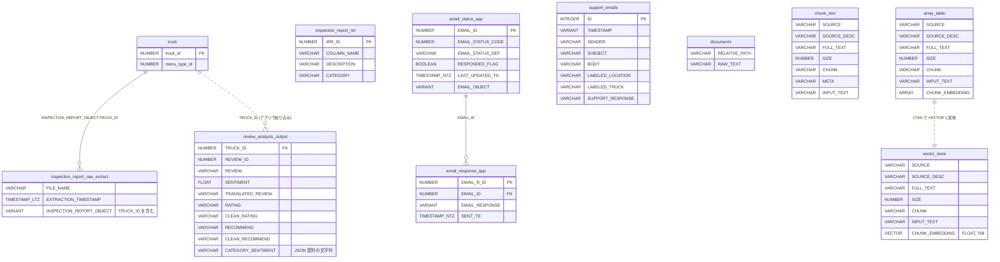
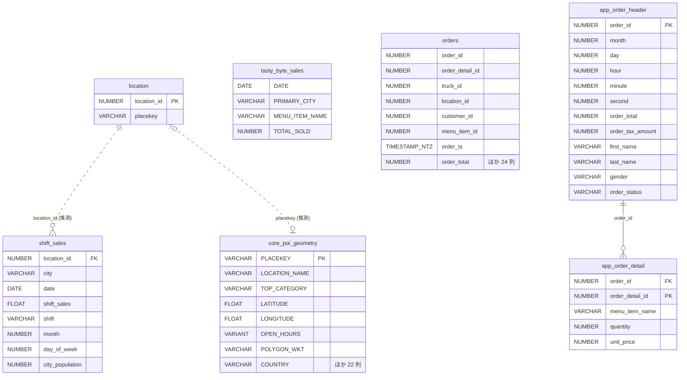

# ER 図

[全テーブル作成ノートブック](../../notebooks/tasty_bytes_load_all_tables.ipynb)がデータベース `tasty_bytes_all` に作る 31 テーブルの関係を、領域ごとに 4 つの図で示します。

## 図の読み方

- どのセットアップ SQL も、主キー・外部キーの制約を宣言していません。図の `PK` / `FK` は、結合に使われる列や dbt の説明（「Primary key for ...」など）から付けた**論理的なキー**です。
- **実線**: 教材の SQL・アプリのコードで、その列による結合が実際に使われている関係です。根拠は[関係の一覧](#relations)にあります。
- **点線**: 列名と値の役割から推測した関係です。ソースには結合の例がありません（**[推測]**）。
- 多重度（1 対多など）は、列の役割から判断したものです。ソースで一意性が保証されているわけではありません（**[推測]**）。
- 型は図を読みやすくするため、桁数を省いています（例: `NUMBER(38,0)` → `NUMBER`）。正確な型は各ページとノートブックを参照してください。
- 図の中のテーブル名はスキーマ名を省いています。スキーマは各図の下の表にあります。

<a id="pos"></a>

## 1. POS とレビュー（中核）



| テーブル | スキーマ | 備考 |
| --- | --- | --- |
| `country`, `franchise`, `location`, `menu`, `truck`, `order_header`, `order_detail` | `raw_pos` | 列の説明は [中核データモデル](core-pos-model.md) |
| `customer_loyalty` | `raw_customer` | 会員でない顧客の注文もあるため、`orders_v` は左外部結合 |
| `truck_reviews` | `raw_support` | `review` は多言語の自由記述（[非構造化データ](unstructured-data.md#truck-reviews)） |

- `country` は、この図のどのテーブルとも結合されていません。教材では気象データの `daily_weather_v` で `iso_country` と `city` を使って結合されます（[Marketplace・第三者データ](marketplace-third-party-data.md)）。
- `menu` には、品目ごとの行と `menu_type_id`（メニュー種別）があります。`truck` は `menu_type_id` を持ち、ブランド名は `menu` 側にだけあります。そのため `truck` と `menu` は多対多の関係として描いています。
- `order_header.location_id` は `FLOAT`、`location.location_id` は `NUMBER` で、型が一致しません（[版による差異](version-differences.md)）。

<a id="supply-chain"></a>

## 2. サプライチェーンと価格（価格最適化）



| テーブル | スキーマ |
| --- | --- |
| `item`, `recipe`, `item_prices`, `menu_prices`, `price_elasticity` | `raw_supply_chain` |
| `menu_item_aggregate_dt` | `harmonized`（名前は `_dt` だが通常のテーブル） |
| `menu`（列は一部のみ表示） | `raw_pos` |

ビュー `harmonized.menu_item_cogs_and_price_v` は `item`・`recipe`・`item_prices`・`menu_prices`・`menu` を次の条件で結合し、品目ごと・期間ごとの原価を計算します。`item_prices` と `menu_prices` は、期間の開始日（`START_DATE`）でも突き合わせます。

```sql
FROM raw_supply_chain.item i
JOIN raw_supply_chain.recipe r       ON i.item_id = r.item_id
JOIN raw_supply_chain.item_prices ip ON ip.item_id = r.item_id
JOIN raw_supply_chain.menu_prices mp ON mp.menu_item_id = r.menu_item_id
                                    AND mp.start_date = ip.start_date
JOIN raw_pos.menu m                  ON m.menu_item_id = mp.menu_item_id
```

<a id="customer-experience"></a>

## 3. 検査レポート・レビュー分析・メール・RAG



| テーブル | スキーマ | 備考 |
| --- | --- | --- |
| `inspection_report_raw_extract`, `inspection_report_ref` | `raw_doc` | 検査レポート画像は内部ステージ `raw_doc.inspection_reports` にある（[非構造化データ](unstructured-data.md#inspection-reports)） |
| `review_analysis_output` | `analytics` | |
| `email_status_app`, `email_response_app`, `support_emails` | `raw_support` | |
| `documents`, `chunk_text`, `array_table`, `vector_store` | `harmonized` | |
| `truck`（列は一部のみ表示） | `raw_pos` | |

- `inspection_report_raw_extract` は、`VARIANT` 列の中の値 `INSPECTION_REPORT_OBJECT:"TRUCK_ID"[0].value` で `truck` と結合されます（ビュー `harmonized.inspection_reports_v`）。
- `inspection_report_ref` は、列ではなく**検査項目名**（`COLUMN_NAME`）で、検査結果を縦持ちにしたビュー `inspection_reports_unpivot_v` と結合されます。テーブル同士の関係ではないため、線を引いていません。
- `review_analysis_output` について、アプリは `inspection_reports_v` から選んだ `TRUCK_ID` で絞り込みます。結合ではないため点線にしています。`REVIEW_ID` と `truck_reviews.review_id` の関係は、ソースからは確認できません。
- `documents`、`chunk_text`、`support_emails` は、ほかのテーブルと結合する列を持ちません。`vector_store` の `SOURCE` は、アプリが `'PUBLIC'` / `'EMAIL'` の絞り込みに使います。

<a id="analytics-app"></a>

## 4. 分析用データとアプリ用データ



| テーブル | スキーマ | 備考 |
| --- | --- | --- |
| `shift_sales`, `tasty_byte_sales` | `analytics` | `tasty_byte_sales` は ID 列を持たず、都市名と品目名で集計されたデータ |
| `core_poi_geometry` | `raw_safegraph` | SafeGraph 形式の POI（30 列） |
| `orders`, `app_order_header`, `app_order_detail` | `app` | `orders` は `harmonized.orders_v` と同じ 32 列の非正規化テーブルで、ほかのテーブルとは独立している |
| `location`（列は一部のみ表示） | `raw_pos` | |

- Snowpark 101 は `shift_sales.location_id` を SafeGraph（Marketplace）の `location_id` と結合します。`raw_pos.location` と結合する例はソースにありません。
- Power BI の教材は、`location.placekey` で SafeGraph と結合できると説明しています。ただし `core_poi_geometry` は、教材が S3 から読み込む別のコピーです。
- `app_order_header` と `app_order_detail` は、ビュー `data_app_orders_v` で `order_id` によって結合されます。

<a id="relations"></a>

## 関係の一覧と根拠

| 関係 | 種類 | 根拠 |
| --- | --- | --- |
| `order_detail.order_id` → `order_header` | 実線 | `harmonized.orders_v`（[`setup.sql`](../../snowflake_contents/github/common_resources/sfguide-getting-started-from-zero-to-snowflake/scripts/setup.sql)（[原本](https://github.com/Snowflake-Labs/sfguide-getting-started-from-zero-to-snowflake/blob/e12f556e2c23c155ddc6ac8a1be4953bb93332b0/scripts/setup.sql)）） |
| `order_header.truck_id` → `truck` | 実線 | 同上 |
| `order_header.location_id` → `location` | 実線 | 同上 |
| `order_header.customer_id` → `customer_loyalty` | 実線（左外部結合） | 同上 |
| `order_detail.menu_item_id` → `menu` | 実線 | 同上 |
| `truck.franchise_id` → `franchise` | 実線 | 同上 |
| `truck.menu_type_id` ↔ `menu.menu_type_id` | 実線 | `harmonized.truck_reviews_v`（同上） |
| `truck_reviews.order_id` → `order_header` | 実線 | 同上 |
| `recipe.item_id` → `item`、`item_prices.item_id`、`menu_prices.menu_item_id`、`menu` | 実線 | `harmonized.menu_item_cogs_and_price_v`（[`tb_po_setup.sql`](../../snowflake_contents/github/cortex_ai_machine_learning/sfguide-price-optimization-using-snowflake-notebooks-and-streamlit/scripts/sql/tb_po_setup.sql)（[原本](https://github.com/Snowflake-Labs/sfguide-price-optimization-using-snowflake-notebooks-and-streamlit/blob/ea6f0cf42587e4b238f24a6514f8e2c1a1b89f08/scripts/sql/tb_po_setup.sql)）） |
| `price_elasticity.menu_item_id` → `menu` | 点線 | 列名からの推測 |
| `menu_item_aggregate_dt.menu_item_id` → `menu` | 点線 | 列名からの推測 |
| `inspection_report_raw_extract`（VARIANT 内の `TRUCK_ID`）→ `truck` | 実線 | `harmonized.inspection_reports_v`（[`setup.sql`](../../snowflake_contents/github/cortex_ai_machine_learning/sfguide-tasty-bytes-enhancing-customer-experience/customer-experience-app/setup/setup.sql)（[原本](https://github.com/Snowflake-Labs/sfguide-tasty-bytes-enhancing-customer-experience/blob/e62390203119710f8bbe8abe095c53f663c3581b/customer-experience-app/setup/setup.sql)）） |
| `review_analysis_output.truck_id` → `truck` | 点線 | アプリの絞り込み条件（[`Dashboard.py`](../../snowflake_contents/github/cortex_ai_machine_learning/sfguide-tasty-bytes-enhancing-customer-experience/customer-experience-app/app/Dashboard.py)（[原本](https://github.com/Snowflake-Labs/sfguide-tasty-bytes-enhancing-customer-experience/blob/e62390203119710f8bbe8abe095c53f663c3581b/customer-experience-app/app/Dashboard.py)）） |
| `email_response_app.email_id` → `email_status_app` | 実線 | 履歴ページの `JOIN`（[`02_History.py`](../../snowflake_contents/github/cortex_ai_machine_learning/sfguide-tasty-bytes-enhancing-customer-experience/customer-support-email-app/app/pages/02_History.py)（[原本](https://github.com/Snowflake-Labs/sfguide-tasty-bytes-enhancing-customer-experience/blob/e62390203119710f8bbe8abe095c53f663c3581b/customer-support-email-app/app/pages/02_History.py)）） |
| `array_table` → `vector_store` | 点線（変換） | `CREATE TABLE ... AS SELECT ... ::VECTOR(FLOAT, 768)`（[`setup.sql`](../../snowflake_contents/github/cortex_ai_machine_learning/sfguide-tasty-bytes-enhancing-customer-experience/customer-support-email-app/setup/setup.sql)（[原本](https://github.com/Snowflake-Labs/sfguide-tasty-bytes-enhancing-customer-experience/blob/e62390203119710f8bbe8abe095c53f663c3581b/customer-support-email-app/setup/setup.sql)）） |
| `app_order_detail.order_id` → `app_order_header` | 実線 | `harmonized.data_app_orders_v`（[`developing-tasty-bytes-react-native-application-with-snowflake-sql-api.md`](../../snowflake_contents/training/application_development/developing-tasty-bytes-react-native-application-with-snowflake-sql-api.md)（[原本](https://github.com/Snowflake-Labs/sfquickstarts/blob/b186c148d09b971fcf99e693ffa70312b196e0ec/site/sfguides/src/developing-tasty-bytes-react-native-application-with-snowflake-sql-api/developing-tasty-bytes-react-native-application-with-snowflake-sql-api.md)）） |
| `shift_sales.location_id` → `location` | 点線 | 列名からの推測（Snowpark 101 の結合先は SafeGraph） |
| `location.placekey` ↔ `core_poi_geometry.PLACEKEY` | 点線 | 列名からの推測（[`end-to-end-analytics-with-snowflake-and-power-bi.md`](../../snowflake_contents/training/bi_analytics/end-to-end-analytics-with-snowflake-and-power-bi.md)（[原本](https://github.com/Snowflake-Labs/sfquickstarts/blob/b186c148d09b971fcf99e693ffa70312b196e0ec/site/sfguides/src/end-to-end-analytics-with-snowflake-and-power-bi/end-to-end-analytics-with-snowflake-and-power-bi.md)） は Marketplace の SafeGraph との結合を説明） |

## 関連ページ

- [中核データモデル](core-pos-model.md)
- [教材固有のテーブル](tutorial-specific-tables.md)
- [半構造化データ](semi-structured-data.md)
- [非構造化データ](unstructured-data.md)
